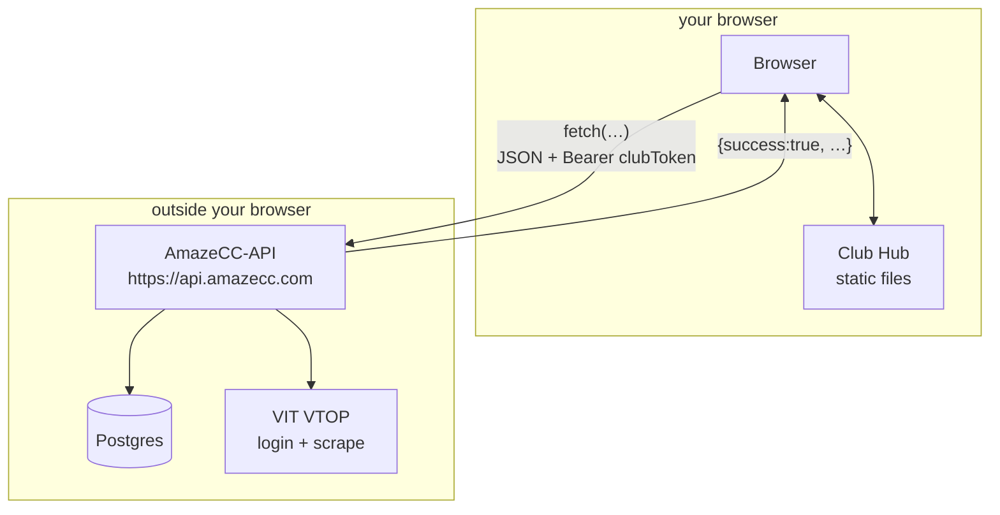

# Architecture

> **In one line:** a static file on GitHub Pages, a browser-side React app inside it, and a remote API that does all the real thinking - that's the whole architecture.

These pages follow that sentence from outside in:

| Page | The question it answers |
|---|---|
| [The static export](./static-export.md) | what "static" means here, and why there's no server |
| [react-native-web & amazeui](./react-native-web.md) | what those imports mean, and why the code doesn't say `
` |
| [Layout & theming](./layout-and-theming.md) | what `layout.tsx`, fonts and themes do |
| [The AmazeCC context](./amazecc-context.md) | how Club Hub connects to everything else in the family |

**The diagram, as a promise:**

## Where to next

- **[The static export](./static-export.md)**
