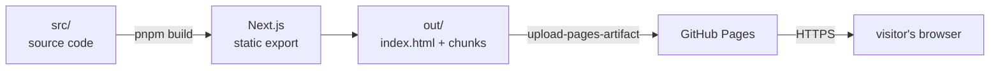

# The static export

> **In one line:** instead of running a program on a server, this app ships pre-made files; the browser does 100% of the thinking at view time.

## What "static" means here

Normally, when you visit a website, a **server** receives your request, runs code, computes what page to show, and sends it. That model needs a machine that's always on, costs money, can crash, and needs patching.

Club Hub skips it. **Static** means: everything that can be done ahead of time, was done at **build time** (when a developer runs `pnpm build` on their machine). The result is a folder of files. Any computer anywhere - a laptop, a CDN, GitHub Pages - can serve them. Nobody's server has to stay awake for you.

## The config that makes it happen

```ts
// next.config.ts — the whole deal in three lines
const nextConfig: NextConfig = {
  output: 'export',          // <-- build to files, not to a server
  trailingSlash: true,       // <-- /path/ serves /path/index.html — required by static hosts
  transpilePackages: ['@amazecontinuityprojects/amazeui'],  // so our theme system works
  webpack: (config) => ({/* webpack tweaks for react-native-web */}),
};
```

`output: 'export'` is the load-bearing line. During `pnpm build`, Next.js:

1. renders every page to static HTML (a shell + JS bundle),
2. inlines every `process.env.NEXT_PUBLIC_*` value as a literal into that JS,
3. writes it all to `out/`.

`nextjs.yml` then uploads `out/` to GitHub Pages. **`out/index.html` existing is the only "is it alive?" test the pipeline uses** (`test -f out/index.html`).



## What you can and cannot do

**You CAN:** client-side routing-ish behavior, fetches everywhere, any UI library, anything the browser itself supports.

**You CANNOT:** API routes (`app/api/*/route.ts`), server actions, `next/headers`, cookies set by the server, ISR/SSR/revalidation, database access at request time, `process.env.SECRET_THING`. Anything needing a secret or a database must happen in the API instead.

**You MUST remember:** every `NEXT_PUBLIC_*` you reference is baked into the JS bundle **forever, for everyone to read**. There is no "secure later" switch for those. This is why `NEXT_PUBLIC_API_URL=http://localhost:3000` in the committed `.env` produces a production build that calls localhost on every visitor's machine ([env vars](../04-operations/env-vars.md)).

## Why it's fine for this app

- The only privileged thing is writing/reading club data - all of that lives at the API.
- The UI is small; client-side rendering is imperceptible on mobile.
- Pages **never** go stale in a harmful way: at worst they're one deploy behind.
- Cost: $0. GitHub Pages + free DNS + free TLS.

<Note>
**"Static" doesn't mean "unchangeable".** It means the *shell* is precomputed;
the *data* is fetched live on every visit. Your feed shows today's posts,
although the HTML file is from last deploy.
</Note>

## Where to next

- **[react-native-web & amazeui](./react-native-web.md)**
- **[The AmazeCC context](./amazecc-context.md)**
