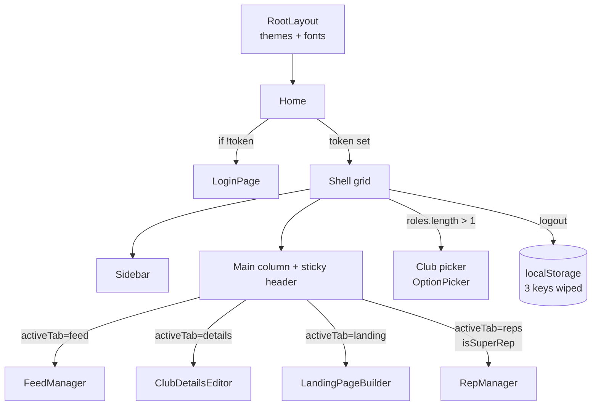

# The page & its tabs

**File:** `src/app/page.tsx` · **Layer:** the only route in the app · **Our focus:** the frame every tab renders inside

> **In one line:** the only screen decides who you are, which club you're editing, and which tab you see - everything else lives inside four tab components.

## The big picture as a graph



> There is no router beyond `activeTab`; switching tabs unmounts/remounts the branch via `key={`${tab}-${activeClubId}`}`.

```
┌──────────────┬───────────────────────────────────────┐
│  top bar:    │  Club Hub   [club picker] [theme] [⚙] │   ← small screens only
├──────────────┴───────────────────────────────────────┤
│  Sidebar   │  sticky header: "Feed Manager"          │
│  - Feed    │  + one-line description + "Active" dot  │
│  - Details │                                           │
│  - Landing │  TAB CONTENT (one of four components)     │
│  - Reps *  │                                           │
└────────────┴───────────────────────────────────────────┘
* only if super rep                                    bottom nav on phones
```

## The state, explained

```tsx
const [token, setToken] = useState<string | null>(null);
const [roles, setRoles] = useState<any[]>([]);
const [activeClubId, setActiveClubId] = useState<string | null>(null);
const [activeTab, setActiveTab] = useState<string>("feed");
```

| Piece | Meaning in plain words |
|---|---|
| `token` | "Did I get my club badge yet?" - `null` until login; the login form is the whole screen until it flips. |
| `roles` | "Which clubs do I represent?" - happens after login; needed to render the picker and know if I'm a super rep. |
| `activeClubId` | "Which club's settings am I changing?" - `feed-…` keys remount the tab on change. |
| `activeTab` | which of the four screens is visible. Defaults to Feed. |

## Boot time, step by step

```tsx
useEffect(() => {
  const storedToken = getClubToken();            // token from localStorage, or null
  if (storedToken) {
    setToken(storedToken);
    const storedRoles = deduplicateRoles(JSON.parse(localStorage.getItem("club_roles") || "[]"));
    setRoles(storedRoles);
    const storedActive = localStorage.getItem("active_club_id");
    if (storedActive && storedRoles.find(r => r.club_id === storedActive))
      setActiveClubId(storedActive);              // keep your club if you still represent it
    else if (storedRoles[0]) {
      setActiveClubId(storedRoles[0].club_id);    // otherwise take the first one you represent
      localStorage.setItem("active_club_id", storedRoles[0].club_id);
    }
  }
}, []);                                          // [] = run exactly once on mount
```

In plain words: on every page load, check localStorage for a saved session; if it exists and your clubs list is intact, restore exactly where you left off. If localStorage is corrupt, the try/catch quietly resets to logged-out state.

## The three handlers

- **`switchClub(id)`** - writes `active_club_id` and updates state; tab components unmount/remount via the `key` trick.
- **`handleLogin(token, roles)`** - receives what LoginPage got back, dedupes roles (super wins), sets state, remembers the first club.
- **`handleLogout()`** - **deletes the three localStorage keys**. No API call; the server cannot revoke anything; the session dies client-side.

## The conditional that decides your screen

```tsx
if (!token) return <LoginPage onLogin={handleLogin} />;
```

Everthing above this line is "logged in" world: sidebar, tabs, editors. Everything below is the shell when a token exists. **There is no router beyond the tab state** - no `/feed` URL, just React state. Refresh kills `activeTab` back to Feed (state resets); `activeClubId` survives (localStorage).

## The `isSuperRep` gate

```tsx
const activeRole = roles.find(r => r.club_id === activeClubId)?.role;
const isSuperRep = activeRole === "super-club-rep";
```

Only your role **for the club you're currently editing** matters. You might be a super rep for Club A and a mere rep for Club B - the tab shows itself only while editing Club A. The badge/visibility in `Sidebar`, the bottom mobile nav and the render branch all consult this same two lines.

## Where to next

- **[LoginPage](./login-page.md)** - what comes before this screen.
- **[Sidebar](./sidebar.md)** - the desktop nav twin.
- The four tabs themselves, one page each.
