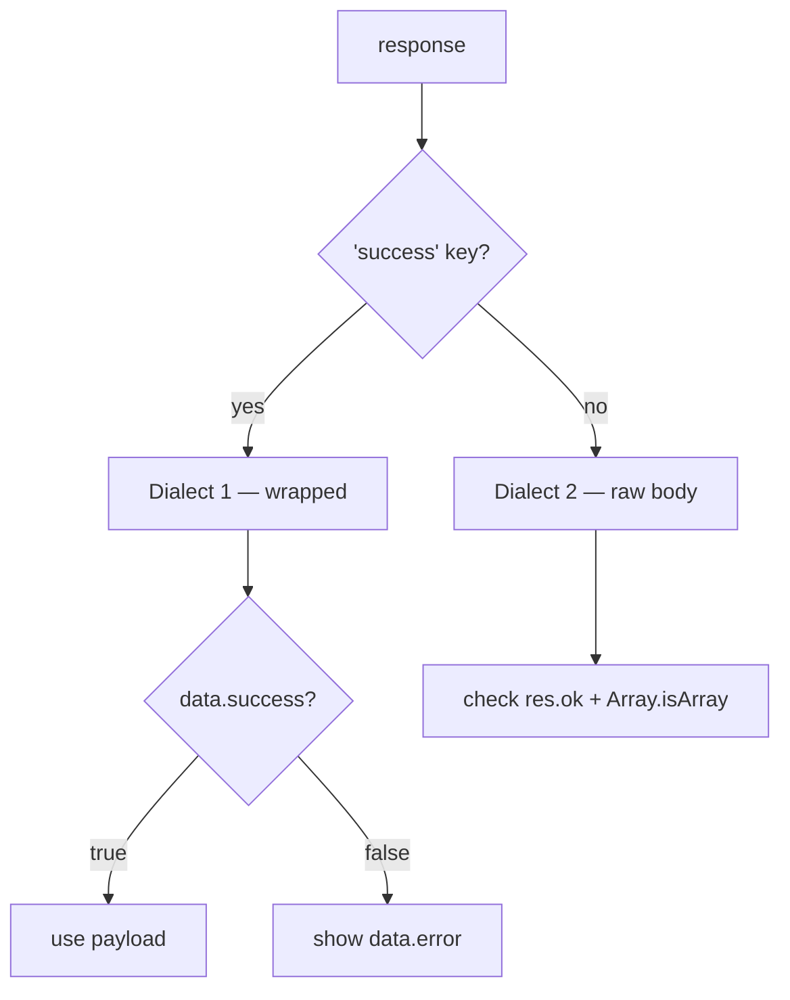

# Envelopes & errors

> **In one line:** most answers start `{ "success": … }`; a few don't — learn the two dialects and the few ways code deliberately swallows errors.

## Dialect 1 — wrapped (almost everything)

```json
{ "success": true, "post": { "id": 7, … } }
{ "success": false, "error": "Content is required" }
```

Your job as an engineer on this codebase:

1. Parse JSON.
2. Test `data.success`. Never trust HTTP status alone.
3. On false, show `data.error` (user-visible) — it's always English.

## Dialect 2 — raw (exactly one route)

`GET /api/events` returns a bare JSON array. Code detects it with `res.ok` + `Array.isArray(…)`. Nothing else. (If you ever add a new raw route, document it here and in `03-api-integration/`.)

## Which dialect is this endpoint?



## The swallow list


These are deliberate, not lazy:

| Swallow | Where | Why |
|---|---|---|
| `AbortError` after unmount | every `useEffect` cleanup | StrictMode double-mounts in dev; a stop-signal isn't an error |
| Failed initial fetch → empty state | all four tab managers | a spinner forever is worse than a blank feed |
| Dev convenience env keys | `LoginPage` | harmless, public, default empty |

## Errors that look like success

- `200 + { success:false }` — the server processed your request just fine, it just doesn't like what you said. **Status 200 does not mean "do what I asked" here.**
- `401 + { success:false }` — your club token is invalid/expired. The app shows empty states, no redirect (known issue).
- `503 + sanitized "Database temporarily unavailable"` — the API's DB broke; retry later.

## One rule to keep your sanity

When in doubt: `console.log(res.status, await res.clone().text())`. The API is readable with `curl`; reproduce any screen in a terminal with `curl -H "Authorization: Bearer $CLUB_TOKEN" https://api.amazecc.com/api/…`.

## Where to next

- **[Operations → security](../04-operations/security.md)**
- **[Known issues](../05-reference/known-issues.md)**
